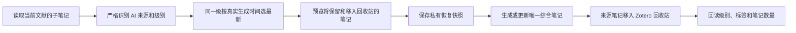

# AI 生成笔记合并设计

## 目标

每篇文献最终只维护一条综合笔记。综合笔记按 L1 概览、L2 证据卡、L3 深度阅读排列，可被原版 AI Butler 的“总结 → AI 总结”直接识别。合并过程不调用模型，不永久删除来源笔记，也不改动人工笔记。



## 1. 来源识别

只合并以下两类来源：

1. Literature Flow 笔记：具有有效的私有任务记录，且记录中的 parent、scope、stage 可以核对。
2. AI Butler 笔记：具有 `AI-Generated`、`AI-Summary` 或 `AI-DeepRead` 标签，并且正文结构能完整识别为 L1、L2 或 L3。

标签本身不作为完成证据。只有标签、正文不完整或级别无法确定时，标为“待核对”，不自动合并。没有明确 AI 身份的人工笔记始终保持原样。

一条来源笔记可以同时包含多个级别。系统先拆成独立的 L1、L2、L3 内容块，再分别选择版本。

## 2. 同级版本选择

每个级别只保留一个版本。排序依据依次为：

1. Literature Flow 记录中的 `created`，或 AI Butler 元数据中的 `generatedAt`。
2. Zotero `dateModified`。
3. Zotero `dateAdded`。
4. 条目 ID 和 key，作为日期完全相同时的稳定排序条件。

这样可以避免仅因 Zotero 同步或重新保存而把旧模型结果误认为最新结果。预览表需要显示每个候选的生成时间、修改时间和最终选中原因。

## 3. 综合笔记结构

综合笔记正文保持简洁，不写供应商、模型、生成时间、输入方式、校验免责声明或内部任务记录。没有结果的级别不生成空标题。

```markdown
# 综合阅读 · 论文标题

## [L1] 一句话概览

核心结论、数据可用性和数据编号。

## [L2] 证据卡

研究问题、设计、样本、方法、主要结果、定量证据和证据等级。

## [L3] 深度阅读

知识缺口、机制解释、证据边界、局限性和可复用研究思路。
```

在 Zotero 内部，Markdown 渲染成可编辑的原生 Note HTML。综合笔记使用：

- `LF:Note`
- `LF:Combined`
- `AI-Summary`

`AI-Summary` 用于原版 AI Butler 识别和预览；工作流维护记录保存在执行端私有状态，不显示在正文中。

## 4. 合并已有笔记

用户选择文献或分类后，先显示只读预览表：

| 文献 | L1 | L2 | L3 | 同级重复 | 处理结果 |
|---|---|---|---|---:|---|
| Paper A | 最新 2026-10-20 | 最新 2026-10-21 | 缺失 | 2 | 创建综合笔记，3 条来源移入回收站 |
| Paper B | 待核对 | 完成 | 完成 | 0 | 暂停，保留全部来源 |

确认后逐篇处理：

1. 重新读取父条目和全部子笔记。
2. 检查它们是否与预览时一致。
3. 在 profile 的 `literature-flow-v1/note-backups/` 写入私有 JSON 快照。
4. 创建或更新唯一的综合笔记。
5. 将所有已经明确识别的分散 AI 来源笔记移入 Zotero 回收站。
6. 回读综合笔记级别、AI Butler 标签、来源笔记删除状态和内容哈希。

任一步骤失败都停止处理当前文献。没有成功备份时不得删除来源笔记。

## 5. 后续增量更新

后续 L1、L2、L3 结果都更新同一条综合笔记：

- 新 L1 只替换 L1 内容块。
- 新 L2 只替换 L2 内容块。
- 新 L3 只替换 L3 内容块。
- 其他级别和级别外的人工补充保持不变。
- 写回前如果发现用户同时编辑了将被替换的内容块，任务转为“待核对”，不覆盖用户修改。

重复执行合并必须是幂等操作：没有新来源时，不改变综合笔记正文、不新增备份、不创建第二条综合笔记。

## 6. 冲突与恢复

以下情况停止自动合并：

- 同一文献存在两条活动的 `LF:Combined` 笔记。
- 来源只有 AI 标签但结构不完整。
- 无法确定来源属于 L1、L2 还是 L3。
- 预览后来源笔记被编辑、删除或新增。
- 综合笔记的目标内容块被人工修改，且无法证明可以安全替换。
- 条目不可写或不属于当前库范围。

来源笔记使用 Zotero 删除标记移入回收站，不做永久删除。恢复时可从私有快照或 Zotero 回收站还原。

## 7. 验收条件

一次合并完成后应满足：

- 每篇文献恰好一条活动的综合笔记。
- L1、L2、L3 顺序固定，同级只保留选中的最新结果。
- 原版 AI Butler 显示一个可预览的 AI 总结版本。
- 明确识别的分散 AI 来源全部进入回收站。
- 人工笔记、未识别笔记和其他级别内容不变。
- 模型请求数不增加。
- 重复合并不再产生变化。
- Zotero 重启后结果、私有记录和自动化状态仍保持一致。

## 8. 与 0.4.5 的关系

0.4.5 已实现严格来源识别、按 L1 → L2 → L3 合并、唯一综合笔记、AI Butler 预览标签、写前备份、来源移入回收站、并发修改保护和幂等执行。下一步应把“同级取最新”从单纯使用 Zotero `dateModified` 改为优先使用 AI 结果的真实生成时间，并在预览表中明确显示版本选择依据。
