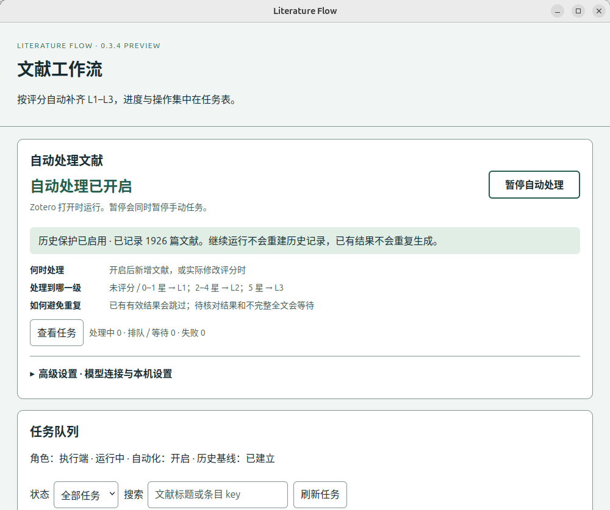

# 0.3.4：简化自动化设置

P520 已更新到 Literature Flow 0.3.4，与原版 AI Butler 5.1.0 配合使用。原有迁移记录与全量备份继续保留，见 [P520 正式迁移](P520_PRODUCTION.md)。

## 日常使用

1. 打开 **Literature Flow · 工作流与队列**。顶部直接显示“自动处理已开启 / 已暂停 / 未开启”。
2. 点击 **暂停自动处理** 暂停整个队列，包括手动任务；点击 **继续自动处理** 恢复。恢复沿用既有历史记录。
3. 点击 **查看任务** 跳到任务表，可搜索、筛选、取消或重试。已有笔记保留。

首次使用只需展开 **高级设置**，填写模型服务地址、模型名和密钥，点击 **保存并开启**。新设备需要确认本机是唯一执行设备；初始同步未完成时保持暂停。首次开启只记录当前库，不批量处理历史文献。

“更多控制”内保留只阅读 / 执行 / 停用角色、只恢复手动队列、关闭自动触发、配置导入导出。“关闭自动触发”取消未完成自动任务，保留手动任务；“暂停”保留任务。暂停后的旧响应不能写回，已发往服务端的推理不保证立即停止。

## 本次变更

- 将原先分散的保存、角色切换、恢复和自动化操作合并为日常主按钮与首次“保存并开启”。
- 自动化卡显示评分规则、历史保护和进行中 / 排队等待 / 失败任务数量，任务表移到手动操作之前。
- 高级连接和角色配置默认折叠；保留浅色与深色的明确前景、背景配色。
- 开启自动化时复用已有 baseline 与 enabledAt，防止用户把“继续”误当成重新建库；暂停、导入配置或关闭插件会使正在进行的开启操作失效。

## 验证与状态

- 59 项 Node 测试通过；语法、XHTML、XPI ZIP、冻结提示词哈希及私密端点检查通过。
- P520 Zotero 9.0.1 原生窗口实际点击“继续 → 暂停 → 继续”，按钮与状态正确。高级设置默认收起、字体 16px。
- 独立原生窗口使用模拟 API 验证首次设置、保存并开启、角色显示同步；未调用真实模型。
- 1,926 篇历史基线及最初启用时间保留，1,942 条笔记正文不变。条目字段、评分及父条目标签不变；之前已记录的原版 Butler 给两条旧摘要补加 AI-Summary 标签仍是仅有例外。
- 更新期间无推理请求或新增任务；旧自定义方案与其 86 项队列继续封存，原版 Butler 自动扫描关闭。临时测试插件已卸载。
- 证据见 [自动化验证数据](automation-ui-validation.json)。其中 historyReadback 是关闭 Zotero 后的 SQLite 完整性检查；restartReadback 是随后启动生产实例的独立读回。

本次增量备份在 P520 `/home/xiqing/literature-flow-migration/20261022-215313/automation-ui-0.3.4/`，含升级前状态、偏好及 0.3.3 XPI。原来的 11 GB 全量备份未改动。Mac Zotero 未安装更新。

XPI SHA-256：`128d0f47025dd1d6e943377427d8781ba0ecd45b86dd64a46ed62aa562fbbd96`。
