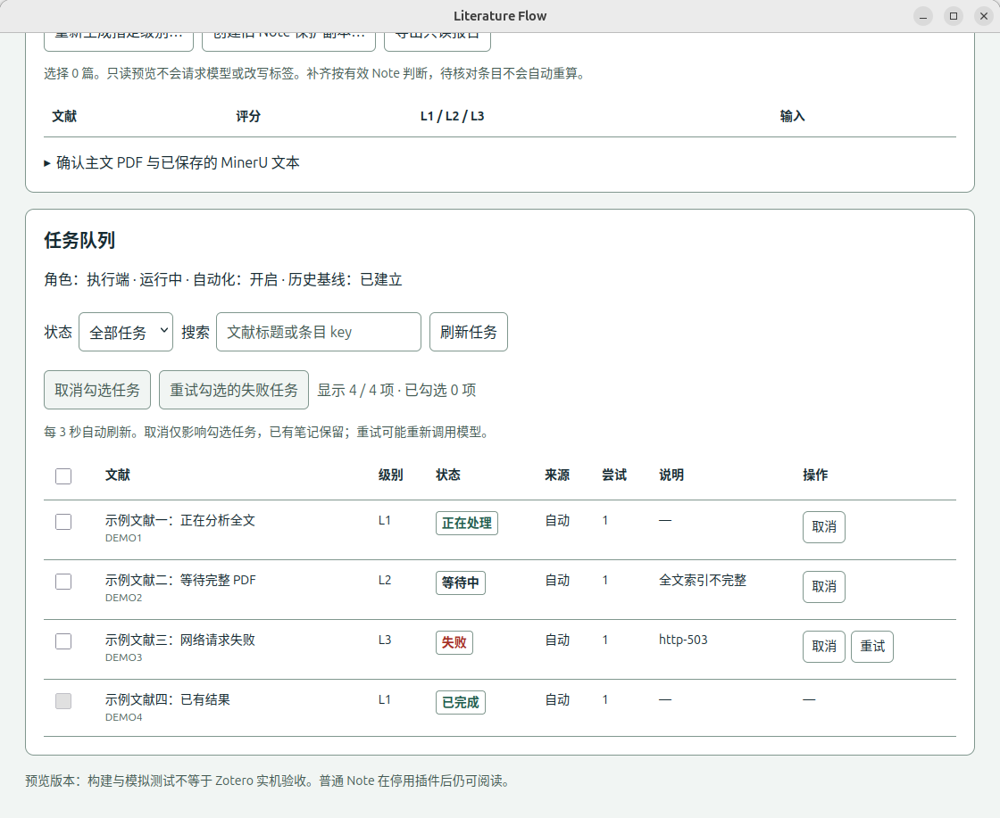

# P520 正式迁移与任务面板 · 2026-10-22

用户授权先备份、核对历史结果，再启用 Literature Flow + 原版 AI Butler，并要求修复字体可读性及增加可操作的任务表。版本为 Literature Flow **0.3.3** 和作者未经修改的 **AI Butler 5.1.0**，运行于 Zotero 9.0.1。旧定制版 5.1.0.3 继续隔离暂停。

## 备份及历史审计

完整备份在 P520：`/home/xiqing/literature-flow-migration/20261022-215313/`。

- `before/profile/`：原配置、插件、凭据文件及本地偏好。
- `before/data/`：完整 Zotero 数据目录，含数据库和附件。
- 13,205 个文件/链接，11,048,649,080 字节；源和副本逐文件 SHA-256/链接目标校验一致。数据库 `integrity_check=ok`。
- 原数据库 SHA-256：`7e329619e934c3b6bcefbccb04d4e3dc9148aadd7fceb48cb81d93fec4ce871d`。
- 备份及原始审计只留在受限个人目录，不提交公开仓库。

审计范围：1,926 篇个人库文献；1,942 条 Note 数据库记录参与正文哈希核对。

| 级别 | 已有完整结果 | 待核对 | 缺失 |
| --- | ---: | ---: | ---: |
| L1 | 110 | 482 | 1,334 |
| L2 | 169 | 333 | 1,424 |
| L3 | 41 | 344 | 1,541 |

484 篇文献至少有一级待核对。这些数字是结构识别结果，不代表科学内容质量。原 Note、评分、标签均保留，不批量修复或重生成。

最终数据库比较确认所有 Note 正文、文献字段和父条目标签未变。原版 Butler 的 `normalizeMatchedNote` 在显示旧摘要时，为 2 条原有 `AI-Generated` 笔记新增 `AI-Summary` 归属标签，没有删除原标签、修改正文或生成新 Note；该差异单独记入验收记录。

旧队列共 86 项：76 项标记完成，1 项 processing，9 项 pending。后 10 项经逐项核对，**6 项已有完整 L1，4 项需核对**。全部旧队列封存于 `old-queue-private.json`，没有导入新队列。原版 Butler 使用空队列且关闭自动扫描，避免它启动时恢复旧任务。

从数据库副本及 Zotero 实际 API 内容分别使用正式核心代码演练。3 次全库事件重放均为 0 个历史自动任务；补齐演练没有重新规划任何完成、待核对或冲突级别，没有调用模型。Zotero API 去除 Note 外层包装后，正文和归属与数据库副本一致。

## 自动化与防重复

首次基线建立于 **2026-10-22 22:07:31（北京时间）**，包含上述 1,926 篇文献。后续界面升级保留该时间、评分基线及全部历史结果，恢复队列时不重新建立基线。

- P520 为唯一指定执行端。只有新条目或实际评分变化触发规划；历史高星文献不会因迁移或普通元数据更新而补跑。
- 旧摘要格式不完整、残缺级别片段、历史 Butler 聊天结果均保留待核对。已有其他级别不能证明该级结果不存在。
- 只读订阅源不会执行任务。0.3.3 进一步忽略只读/已删除条目的自动事件；清理了此前观察器写入的 39 个只读订阅源基线项，未更改订阅内容。
- 原版 Butler 自动摘要、自动精读及自动一图总结关闭，供手动使用。旧定制包保留在隔离目录及本次备份中。
- Mac 没有安装或修改；只读检查确认其原版 Butler 自动扫描默认关闭。
- 这是 Zotero 运行期间的插件自动化；需要保持 Zotero 打开，不是独立后台服务，也没有跨设备锁。

最终状态及重启读回见 [p520-production.json](p520-production.json)。

## 字体与任务表

0.3.3 使用明确的浅色/深色配色，不依赖 `light-dark()`。正文和表单为 16 px，表格为 14 px，输入框、下拉选项、提示及禁用状态均有明确文字和背景颜色。

任务表显示文献标题、级别、状态、来源、尝试次数及原因。支持状态筛选、标题/key 搜索、逐条取消、勾选批量取消、失败重试，每 3 秒刷新。取消不删除已有 Note，暂停时也能取消；重试要求执行端恢复运行。完成任务不能取消或重试。

入口：Zotero 的“工具 → Literature Flow · 工作流与队列”，向下找到“任务队列”。上方“当前选择”针对所选文献，下方表格操作仅针对勾选的具体任务。

以下为 P520 实机内存样例截图，不是真实文献任务：

53 项自动化测试通过，涵盖精确任务取消、在途响应失效、暂停时取消、失败重试权限，以及只读订阅源隔离。实机表格交互使用独立内存样例，不向正式库插入测试条目或发起推理。升级后重启 Zotero 以刷新界面样式缓存。此前真实 L1–L3 推理和原版 Butler 共存验证保留在 [P520_TEST.md](P520_TEST.md)，本次没有为验证而重复请求模型。

## 包校验及回滚

- LF 0.3.3 XPI SHA-256：`5b742cd719c33c11fd14bf8419a17d9e7876d2cedc67547bf60808927fd48b40`。
- 原版 Butler 5.1.0 XPI SHA-256：`5ffc86bc4a0eea2ca618dde628cc8174ddea9c64a0cdb25b2717016457a1f175`，来自[作者发布页](https://github.com/steven-jianhao-li/zotero-AI-Butler/releases/tag/v5.1.0)。
- 旧定制 Butler SHA-256：`480f6b2073da5845d8c58241d3543eaf537c3ff03417fd792c0574fea0b3159f`。

日常回退先在 LF 面板关闭自动化并暂停，再停用插件；保留普通 Note 和本地状态。不要直接恢复旧队列或同时启用两个自动执行端。完整数据库备份用于需要数据恢复的情况，恢复前必须保存迁移后新增数据，避免覆盖后续工作。

临时本地验证工具在验收后卸载；最终插件包不包含该工具。运行证据、私有待核对列表和备份留在上述迁移目录。
